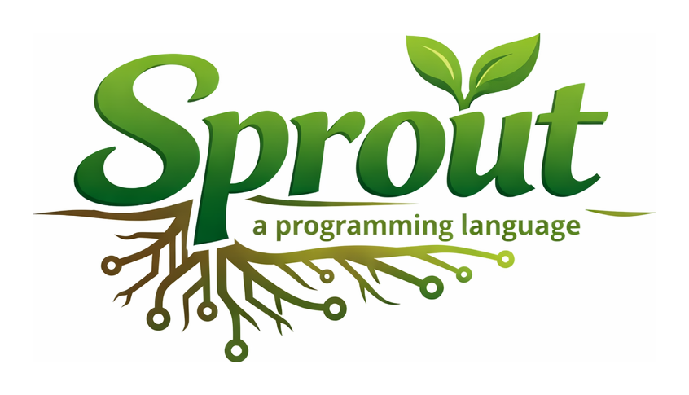

# Sprout

[](https://github.com/cthulhu666/sprout-lang/actions/workflows/ci.yml)
[](./LICENSE)

A statically typed, functional-first programming language aimed at strong safety
with beginner-friendly ergonomics. Sprout compiles to native binaries via LLVM, and
its compiler is written in Sprout.

> **Status: v0.** [`docs/spec-v0.md`](./docs/spec-v0.md) is normative; a feature it
> does not specify may still change.

## Why Sprout

- **Types you rarely write.** Hindley–Milner inference with typeclasses. Exhaustive
  matching, and `Maybe`/`Result` in place of null and exceptions.
- **Purity the compiler checks.** Effects are part of a function's type and are checked:
  IO under a pure signature does not compile, nor does passing an IO function where
  a pure one is expected.
- **Resources released exactly once.** Linear types with `consuming` and `borrowing`
  parameter modes: the compiler checks that a socket or task handle is closed once,
  and never used after.
- **Native and small.** One binary per program, a small C runtime with a GC, and green
  tasks for concurrency. No VM.

## A taste

Read a value, clean and validate it, then respond — with `|>` pipelines and the
two safety idioms `Maybe` (might be absent) and `Result` (might be invalid):

```sprout
module main
import stdlib.string
import stdlib.env as env

fn check(name: String) -> Result String String =
  if string.length(name) > 0 then Ok(name) else Err("empty name")

fn greet(r: Result String String) -> String =
  match r with
  | Ok name -> `Hello, ${name}`
  | Err e   -> `skipped: ${e}`

fn main() -> Unit !{IO} =
  match env.get("USER") with
  | Ok (Just raw) -> raw |> string.trim |> check |> greet |> print
  | Ok Nothing     -> print("no USER set")
  | Err _          -> print("USER is not valid UTF-8")
```

Running with `USER="  Ada  "` prints `Hello, Ada`.

## The language

- **Functional core** — algebraic data types, exhaustive pattern matching, immutable
  values, tuples, records (`p.name`, `p with (name = …)`), function-local `where`
  blocks, `Int`/`Double` with `0x`/`0b` literals.
- **Typeclasses** — `Eq`, `Ord`, `ToString`, `Semigroup`, `Monoid`, `Functor`,
  `Foldable`, … with return-type dispatch and `deriving`. Existential constructors
  (`(any C)`) give trait objects and heterogeneous collections.
- **Effects** — pure functions are unannotated; effectful ones carry `!{IO}`, and
  higher-order helpers take an effect variable `!{e}`. Over-declaring is fine: the
  rule is *inferred ⊑ declared*. `panic` is pure
  ([why](docs/effect-enforcement-v0.md#6-is-panic-an-effect-decided-no)).
- **Linear types** — `consuming`, `borrowing`, `once` and `local` parameter modes.
- **`wrap` newtypes** — zero cost and abstract across a module boundary, so one can
  carry an invariant its inner type cannot. Erased type parameters give units and
  typed handles for free ([guide](./docs/wrap-type-params-v0.md)).
- **Sugar** — `|>`, partial application with `_` holes (`add(_, 1)`), list
  comprehensions (`[x * x for x in 1..n if x > 2]`), `do` for
  `Maybe`/`Result`/`IO`, `let..else`, `try`, template literals.

Implemented but not yet in the spec: green-task concurrency with channels and
`select`, `Char`/Unicode text, `stdlib.regex`, growable `MutVec`.

## Examples

| Example | What it shows |
|---|---|
| [`http_web_server`](./examples/http_web_server.sprout) | Routes and logging middleware on `stdlib.http_server` |
| [`concurrent_fetch`](./examples/concurrent_fetch.sprout) | Three tasks in one scope finish in the time of the slowest |
| [`linear_resources`](./examples/linear_resources.sprout) | A handle the compiler makes you release exactly once |
| [`wrap_typed_money`](./examples/wrap_typed_money.sprout) | Zero-cost distinct types for account ids and cents |
| [`existential_shapes`](./examples/existential_shapes.sprout) | A user-defined interface used as a trait object |
| [`json_demo`](./examples/json_demo.sprout) | Parsing and printing JSON |
| [`digit_recognizer`](./examples/digit_recognizer/) | A neural network that learns handwritten digits (~90% test accuracy) |
| [`aoc_2025_day_1`](./examples/aoc_2025_day_1.sprout) | Advent of Code 2025, day 1 |

The largest Sprout program is the compiler itself, in [`stdlib/compiler/`](./stdlib/compiler/).
All examples: [`examples/`](./examples/).

## Quick start

There are no prebuilt binaries yet, so the compiler is built from source. On macOS or
Linux, clone the repository and run the development setup:

```
./scripts/setup-dev.sh
mise exec -- just run examples/fizzbuzz.sprout
```

`just compile-native <file> <out>` writes the native binary instead of running it.

The setup installs the system and repository-managed toolchain, configures Git hooks, and
bootstraps the self-hosted compiler. It supports Homebrew and the APT, DNF, Pacman, and Zypper
Linux families; on Debian and Ubuntu it installs the required LLVM/Clang 22 from apt.llvm.org.
WSL follows the Linux path. Use `./scripts/setup-dev.sh --print-plan` to inspect what it would
install. Full toolchain, tasks, driver CLI and platform support:
[docs/development.md](./docs/development.md).

## Tooling

- **Formatter and linter** — `just fmt-file <file>` and `just lint-file <file>`.
- **Language server** — `sproutd` serves LSP: diagnostics, go-to-definition, hover,
  completion. A JetBrains plugin lives in [`editors/intellij`](./editors/intellij).
- **REPL** — `just build-sproutd && just repl`.
- **Diagnostics** — errors carry `line:col`, check exhaustiveness, report unknown
  names and missing instances, and many say how to fix the code:

```
ERROR: check: range `range_up(5, 1)` is empty, so it yields no values: the start
bound 5 is above the end bound 1, and it counts upward only. To count downward
write `range_down(5, 1)`
```

## Limits (v0)

- **Diagnostics** show `line:col` only: no file path and no source excerpt yet.
- **Packages** — no package manager. A dotted import outside `stdlib/` needs one
  `--package-root <dir>`, and without it the import fails silently: the error surfaces
  later as `Unknown variable` ([packaging-v0.md](./docs/packaging-v0.md) §10).
- **Effects** — a function's own effect variable is not checked in its body. A call
  through a parameter `g: Int -> Int !{e}` under a pure signature is accepted, and so
  is a function declared `!{e}` whose body does IO (spec §7, enforcement note). Open
  effect rows are not supported.
- **Concurrency** — `select` takes receive cases only, over channels of one type.
- **Syntax** — no operator sections (write `\x -> x * 2`, not `_ * 2`), and a
  lambda body cannot be a multi-statement `do` block.

Coming from Haskell, Rust or Go? Read
[Rules that surprise newcomers](./docs/idiomatic-sprout.md#rules-that-surprise-newcomers).

## Documentation

- **[Language spec (v0, normative)](./docs/spec-v0.md)** — the stable core.
- **[Idiomatic Sprout](./docs/idiomatic-sprout.md)** — start here to write Sprout.
- [Stdlib reference](./docs/stdlib-reference.md) — the `stdlib.*` modules, one section each.
- [Builtins reference](./docs/builtins-reference.md) — host builtins (`extern fn`).
- [Style guide](./docs/style-guide-v0.md) · [stdlib/compiler guidelines](./docs/guidelines.md)
- [Language design](./docs/language-design-v0.md) · [design best practices](./docs/language-design-best-practices.md)
- [HM typechecker guide](./docs/hm-typechecker.md) · [effect enforcement](./docs/effect-enforcement-v0.md) · [records](./docs/records-v0.md)
- [Compiler internals](./docs/compiler-internals.md) · [packaging](./docs/packaging-v0.md) · [language server](./docs/language-server-roadmap.md)
- [Toolchain and build](./docs/development.md) · [debugging](./docs/debugging.md) · [gates](./docs/gates.md) · [bootstrap chain](./docs/bootstrap-chain.md)
- Design drafts: [effect system](./docs/effect-system-v0-plan.md) ([v1](./docs/effect-system-v1-draft.md)) · [int ranges](./docs/int-ranges-v1-draft.md) · [char & text](./docs/char-text-v1-draft.md) · [sequencing sugar](./docs/sequencing-sugar-v1-draft.md)
- [Backlog & roadmap](./BACKLOG.md)

## Repository layout

- `docs/` — design and process documents
- `examples/` — sample programs
- `stdlib/` — standard library (`prelude.sprout` and the `stdlib.*` modules)
- `stdlib/compiler/` — the self-hosted compiler (`parser`, `infer`/`checker`, `ast_to_ir`/`ir_lowering`, `compile_driver`)
- `runtime/` — C runtime, GC, poller and scheduler
- `tests/` — native Sprout tests (`tests/stdlib/`) and behavior fixtures (`tests/conformance/`)
- `bootstrap/` — committed LLVM IR seed for the stage-1 bootstrap
- `mise.toml` / `justfile` — pinned toolchain and common commands

## Contributing

See [AGENTS.md](./AGENTS.md) for collaboration and change rules. Run the test suite
with `mise exec -- just test`.

## License

Apache License 2.0 — see [LICENSE](./LICENSE) and [NOTICE](./NOTICE).
